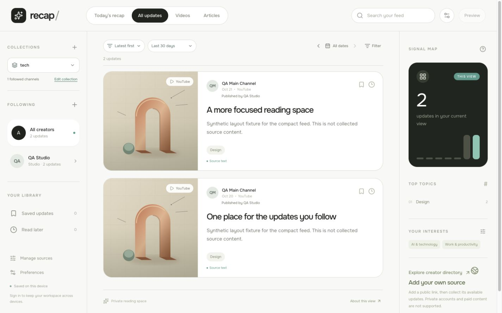
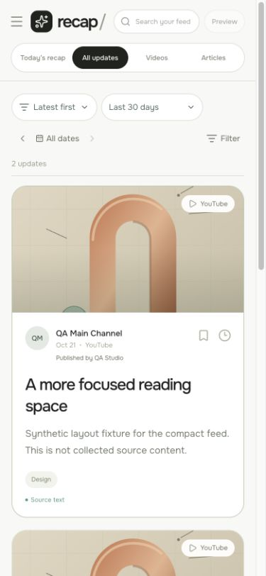
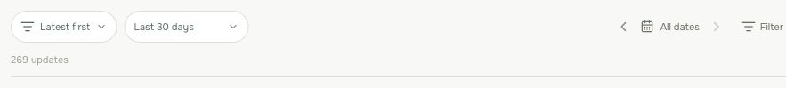

# Compact collection feed — 21 October 2026

Founder request D23: remove the repeated collection introduction and put the reading controls together, so the feed starts near the top of the middle column. This is a scoped design change to the existing v0.

## Design and implementation

Keep the existing Onest typeface and palette: canvas `#f8f8f6`, paper `#ffffff`, ink `#20231f`, lines `#dedfd9`, teal `#519c8d`, supporting text `#687163`. Left-aligned reading controls replace the oversized aggregate collection heading. The collection picker remains in the source rail or phone drawer.

```text
[collection picker] | [sort] [history range]   [date] [Filter]
[source navigation]| 269 updates
                   | [source-linked update cards]
```

This is a density adjustment to the founder's existing design, rather than a new visual system. Aggregate collection views have no visible collection eyebrow, repeated name, subtitle, channel count or source-material banner. A screen-reader heading preserves page context. Creator/source drill-down, saved/read-later and Today headings remain contextual.

Sort, the unlabeled history-range select, date arrows/date and Filter share one desktop toolbar. Long selected dates can shorten visually with an ellipsis; their complete accessible name and tooltip remain. Phones use two compact rows with the same controls and usable hit areas. A small count and divider sit directly above the cards. Sample provenance and save/archive errors retain their existing behavior.

The source-extract explanation and **View source coverage** now live in **Preferences**. This opens the same stored, collection/range-scoped coverage panel. Moving it does not create AI synthesis or change the underlying coverage evidence. The profile coverage control never submits the preferences form.

## Local evidence

Final `npm run check` passed: catalogue reproduces unchanged at 560 creators/600 accounts, **355 tests across 12 files**, TypeScript and production build. The existing large-bundle advisory remains. An independent read-only review found no blocking defect.

Actual browser checks used a separate local guest build with authentication disabled, and an explicitly synthetic `example.org` fixture. No owner record, source dataset or provider was modified. Three fixture items included two recent items and one 45-day-old item.

- **1440×900**: toolbar at y114, first card at y205, all four controls on one line.
- **1051×800**: one control row, including a selected long date. Date shortening preserves Filter on that row.
- **390×844** and **320×740**: two control rows, no horizontal overflow. At 320px the first card starts at y272.
- History range switched from two recent items to all three. Oldest-first put the oldest item first. Previous-day navigation narrowed the list to its one matching item; clearing filters restored both recent items.
- Preferences displayed the moved explanation; its coverage link opened the correct synthetic source and two available items, retaining the incomplete-coverage wording.

T3 preview screenshots timed out twice with `Preview automation snapshot timed out after 15000ms.` Visual verification then used the available Chrome computer-use connector. Temporary responsive viewport overrides were reset.

Saved images show synthetic local fixtures, not the owner's collected history or proof of hosted behavior:





## Release evidence

Functional commit **`e36082c50417d759c7c3146f39d59509b8621801`** is pushed to main and passed [CI 39674698248](https://github.com/raduvlad92/recap/actions/runs/39674698248). Netlify production deploy **`6ad92748a9a47a09d78ef245`** is ready for that exact commit, published **20:58:10 UTC**. The hosted owner browser loaded `index-CTuPneGz.js`.

The actual existing signed-in owner session was verified through a separate Chrome tab. At the same **1496×882** viewport, the first card moved from **y618.33 to y205**, saving approximately **413px** above the feed. Toolbar is at y114; sort, range, date and Filter share a single row. The tech collection remains active with **269** default-window updates and **278** under All available history. The repeated heading/banner are absent and no sync/archive error appears. Preferences shows the source-material explanation, and its coverage link opens **all 39** stored source rows. No settings/follows were edited, and the range was restored to 30 days.

The actual hosted owner view at **390×844** has two control rows, document width **375px** (within the viewport), **269** updates and first card at y275. Responsive overrides were reset. The owner tab is left on the default collection view. No private follow list, identity, email or original content was saved in screenshots: the live crop contains only controls and an aggregate count.



Local guest fixture storage was restored and temporary development servers stopped. No collection job, model execution, transcription, schedule or new supplier spend is part of this increment. Existing hosting/build/database usage is not measured as a total cost. The release record is followed by a documentation-only commit; the executable deployment above is the verified functional release.
