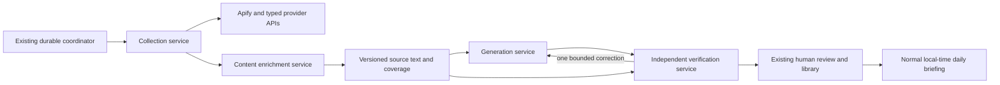

# Ingestion and content-quality repair — 11 November 2026

**Recommendation: qualify better provider routes, split collection/enrichment/generation/verification into restartable services, and use an independent claim checker with strict citation gates.** We already have queues, durable job records, financial admission, retry backoff and AI checks. Preserve those foundations and repair the missing stages and contracts.

The founder explicitly defers backup work and focuses on production-readiness points 2/3. Prefer microservices and better Apify Actors/API providers; do not depend on direct YouTube or Instagram integration. This records the direction and investigation, not successful implementation, a supplier switch, new subscription, extra allowance or publication approval. The current deployment remains unchanged. Backups are deferred, not certified complete.

## Findings that determine the repair

| Finding | Evidence and consequence |
| --- | --- |
| Existing captioned videos can stay stuck on unknown format | [The existing path](../../netlify/functions/_shared/hourly-collection.ts) tries the native caption/watch-page route, then exits when a transcript already exists. It correctly avoids buying captions again, but has no separate provider-backed metadata-only repair. Two new transcripts were excluded by the reader's actual hide-Shorts preference. Add a format-enrichment task; retain the preference and guard. |
| Instagram speech is not imported | [The normalizer](../../netlify/functions/_shared/social-collection.ts) takes visible post/caption text and explicitly says media audio/image text are not collected. A new Actor's transcript field would not automatically reach analysis. Add a typed Reel transcript adapter and preserve caption, speech and image text separately. |
| The active Instagram Actor is a fallback with demonstrated gaps | Fresh SELECT confirms `yugenox/instagram-post-scraper` 0.1.4, three-item / USD 0.01 maximum. Retained examples are blocked or older than their exact windows. The source constant naming `apify/instagram-scraper` is not the active configuration. Do not confuse those facts or count old rows as a repair. |
| A successful run can still have unread content | One retained completed caption run has known settled USD 0.004 cost but its required-text projection still exceeds 2 MiB. Discovery pagination fixed an earlier multi-record case; it does not fix one oversized record. Preserve the old fee/job and differing transcript history. |
| We already double-check, but recap checking lacks model independence | [recapCall](../../netlify/functions/_shared/automatic-content.ts) hardcodes extractor role and extractor model for both draft and check. The actual 12:05 request/response confirms this. Keyword analysis already uses two inventories and an independent checker; adding the same pattern again would waste calls. |
| The new checker is not a sufficient quality gate | Its six verdicts reject two points, but another positive verdict explicitly acknowledges that part of its claim comes from context outside the cited quote. Nearby context may reveal misleading attribution; it cannot supply missing evidence under the current requirement. |
| Keyword volume is a product/review issue as well as a model issue | The ordinary 9305-character source produced 88 pending keyword proposals. Literal entity inventory is intentionally comprehensive. Keep that inventory and its receipts; add compact review/selection for the reader rather than silently deleting names or treating inventory as the display list. |
| Credential health must precede another live comparison | Five metadata GETs using the saved operator Apify key return 401 `user-or-token-not-found`. The existing local managed copy is the same key. A new ordinary X job reports a generic provider error, which is consistent but does not prove the deployed credential's upstream failure. Reconcile existing runtime authority; do not label every historical retrieval failure a credential problem. |

At 20:28 UTC, model commitment is USD 9.998287986 / USD 12 with 977 calls/seven unknown holds. Source commitment is.099/day/.523lifetime under USD 0.10/day / USD 1 lifetime, leaving.001/day and 12 older provider unknowns. A USD 0.02 discovery does not fit. No cap, charge or hold was changed. No new Actor/model job, platform request, credential rotation or publication was made by this investigation. [Sanitized evidence](evidence/ingestion-quality-investigation-2026-11-11.json).

## Provider routes worth qualifying

These are **documented capabilities, not new Therecap access or reliability proofs**. Store ratings, successful provider statuses and low headline prices do not establish fresh useful content. Select one primary and one fallback per stage after a controlled comparison; do not call every provider for every item.

| Role | Preferred candidate and reason | Qualification gap |
| --- | --- | --- |
| YouTube discovery | Retain the Apify-maintained [Streamers YouTube Actor](https://apify.com/streamers/youtube-scraper) as a candidate. Its [input contract](https://apify.com/streamers/youtube-scraper/input-schema) separates regular-video, Shorts and live limits. | Qualify the exact pinned build, channel identity, pagination and a positive regular/Shorts/stream control. Generic `type: video`, a watch URL, dimensions or duration alone do not establish regular format. A request filter alone is not proof that every returned row obeyed it. |
| YouTube captions | Test a focused, single-track timed-transcript route: [Karamelo](https://apify.com/karamelo/youtube-transcripts), with [Pinto](https://apify.com/pintostudio/youtube-transcript-scraper) as another established candidate. Both document timed captions; neither establishes audio transcription when captions are absent. | Compare exact IDs, original language, end-of-source content, cue timing and bounded body size against retained references. A focused Actor may avoid the large generic row, but that remains a hypothesis until measured. |
| Instagram discovery and Reel speech | Prefer qualification of Apify-maintained [Instagram Scraper](https://apify.com/apify/instagram-scraper) for profile posts and [Instagram Reel Scraper](https://apify.com/apify/instagram-reel-scraper) for exact Reels and optional audio transcription. | Replace the active fallback only after pinned-build/input/price review and an in-window positive control. Transcription is an add-on, not included in the headline metadata price. Captions are not Reel speech. |
| Typed API alternative | [Supadata channel videos](https://docs.supadata.ai/youtube/channel-videos) explicitly separates video/short/live IDs. Its [transcript API](https://docs.supadata.ai/get-transcript) supports existing captions or generated speech, timed output and asynchronous jobs across YouTube/Instagram. | Strong documented fit for format enrichment and caption/ASR separation; untested here. An automatic fallback can incur per-minute generation costs. HTTP 202 jobs and result expiry require prompt harvesting. New provider setup is not performed or required for this investigation. |
| Focused API alternative | ScrapeCreators documents [YouTube captions](https://docs.scrapecreators.com/v1/youtube/video/transcript/) and [Instagram speech transcripts](https://docs.scrapecreators.com/v2/instagram/media/transcript/) with optional longer transcription. | Test exact source ownership, original language, timing and long-video timeouts. AI timings are approximate. Its dedicated video/Shorts listing routes need control cases before supplying trusted format evidence. |
| Second collection supplier | Bright Data publishes machine-readable [YouTube](https://docs.brightdata.com/scrapers/youtube.com.json) and [Instagram](https://docs.brightdata.com/scrapers/instagram.com.json) contracts. YouTube includes caption transcripts; Instagram schemas supply post/Reel metadata. | Its YouTube `post_type` is documented as inferred from URL structure, so it does not by itself satisfy our stronger format requirement. Instagram Reel speech is not established by the inspected schema and needs a separate transcription provider. No subscription or live run was started. |

For X, retain the exact empty-run evidence and prepare a known-positive comparison against an API Actor such as [API Dojo's Tweet Scraper](https://apify.com/apidojo/tweet-scraper). Respect route-specific date filters and minimum charges. Keep the current LinkedIn Actor and other advertised source formats subject to the same useful-text contract; this is not a silent reduction of the product to YouTube/RSS.

### Price and admission must cover the work actually requested

- Streamers' [published Free prices](https://apify.com/streamers/youtube-scraper/pricing) are USD 0.004/video and USD 0.048 per transcript-minute add-on. AI descriptions/summaries are different add-ons and must not substitute for original text. Keep them off as source evidence.
- The official Instagram Reel [price table](https://apify.com/apify/instagram-reel-scraper/pricing) lists USD 0.0026/reel and USD 0.001/run on Free, plus USD 0.048 per transcript-minute; [its input documentation](https://apify.com/apify/instagram-reel-scraper/input-schema) specifies per-minute transcription and per-MB download. A one-minute example is about USD 0.0516 before optional downloads, assuming one minute billed. That exceeds the active USD 0.01 Instagram job maximum. It is a planning example, not an incurred charge; billing granularity and current account tier need verification.
- Karamelo's [Free price](https://apify.com/karamelo/youtube-transcripts/pricing) is USD 0.007/transcript; Pinto lists USD 0.01/result. Both exceed the current USD 0.005 hourly-caption maximum. Cheap-looking alternatives do not bypass admission or justify a cap increase.
- Supadata documents 1 credit for existing captions and 2 credits/generated minute. `native` avoids automatic ASR, but an unavailable-transcript 206 can still cost 1 credit; generated no-speech output can be charged. Polling the returned job is distinct from requesting a new transcript. [Contract/pricing](https://docs.supadata.ai/get-transcript), [plans](https://supadata.ai/pricing).
- ScrapeCreators documents 1 credit for YouTube captions and short Instagram AI transcription; its long-transcription mode is 10 credits/minute rounded up, including short clips when enabled. Convert credits using the actual purchased tier, disable automatic top-ups and include every request/add-on. [YouTube](https://docs.scrapecreators.com/v1/youtube/video/transcript/), [Instagram](https://docs.scrapecreators.com/v2/instagram/media/transcript/).

The last cached Apify account receipt was Free; current tier/pricing could not be authenticated. Reconcile real receipts and measure **cost per accepted useful item/minute**, including empty attempts, ASR/OCR, generation, verification and hosting. Preserve all existing ceilings and unknowns. No new allowance or subscription is requested here, and this finite proof budget does not establish sustainable broad hourly coverage.

## Proposed microservices

Use the existing Cloudflare/queue/database foundation. Services can use private [Worker service bindings](https://developers.cloudflare.com/workers/runtime-apis/bindings/service-bindings/) and durable queued work rather than expose new public endpoints or depend on a browser process. No new database, server subscription or platform-specific crawler is needed for this design.

1. **Collection service:** API-first discovery, exact account/post identity, publication windows, pagination, cache and provider run reconciliation. In the new provider-only policy, YouTube/Instagram URLs are identifiers sent to approved vendors, not destinations fetched by our app. An API failure does not silently fall back to app-side platform scraping. Cut over only after the replacement is accepted; this investigation did not disable current delivery.
2. **Content enrichment service:** separate metadata-only format jobs, one original-language caption track, ASR for missing speech and OCR where image text is required. Existing text is never repurchased just to classify format. Keep caption/ASR/OCR/translation and completeness/uncertainty distinct. Do not claim visual-content coverage from speech alone. Avoid fetching signed media URLs ourselves by using reviewed vendor transcription/download services.
3. **Generation service:** reads a complete versioned source, proposes short atomic findings and a separate full entity inventory. It does not approve, mutate sources or publish. Source material and provider text are untrusted data, never agent instructions.
4. **Verification service:** deterministic source/citation gates plus a separately routed checker model. Owns pass/insufficient/contradicted results and the bounded correction decision. It cannot grant owner approval or silently change a negative verdict.

Each stage persists its input hash/revision, contract/build/price version, attempt identity, lease, upstream run/request ID, reservation, actual/unknown charge and outcome before acknowledging completion. Resume the failed stage, not the whole video. Reuse accepted source artifacts and completed model results only for the exact matching contract/source version. Changing provider text or model prompts creates a new version; it never overwrites historical evidence or reopens the completed proof sessions.

Share public-source retrieval where appropriate and fan out accepted results through existing private reader ownership rules. Cost attribution for new shared work must remain explicit; do not reassign historical fees or expose private follow lists.

## Retry policy that does not duplicate purchases

Cloudflare Queues is [at least once](https://developers.cloudflare.com/queues/reference/delivery-guarantees/), and Apify [webhooks retry and can duplicate](https://docs.apify.com/integrations/webhooks/actions). Durable deduplication and lease checks therefore remain mandatory. Authenticate webhook delivery using a secret header where supported, enqueue promptly, then fetch the exact known run under our own authority. A webhook body is not trusted proof of content, identity or cost. A scheduled reconciler covers lost callbacks.

| Outcome | Recovery |
| --- | --- |
| Known run/job still active; HTTP 202 | Save the same run/job ID and poll that status/result endpoint with backoff and a deadline. Do not start another collection/transcription. Supadata results expire about 1 hour after completion, so harvesting must fit the provider's retention window. |
| Retryable status/result read fails with 429/5xx/timeout | Retry that non-creating read with jitter and Retry-After, within bounded attempts/time. Preserve progress and charges. |
| A billable collection/transcription request times out | Treat acceptance as ambiguous, even if HTTP method isGET. Some APIs generate/charge through GET. Reconcile the original intent/request history; do not blindly repeat it. Do not assume run-create idempotency without a documented and tested provider guarantee. |
| Exact run definitively failed | A future policy may admit at most a bounded new attempt or one alternate provider after a fresh budget check, retaining the failed attempt and fee. Initial proposal: one additional execution attempt, not an unlimited restart. Existing completed/ambiguous/historical operations are excluded. |
| Authentication/configuration/schema/build/price failure | Open the provider circuit and report the sanitized cause; retries cannot repair credentials or an unreviewed contract. Keep existing unknowns held. Do not recreate accounts or request another creator login. |
| Empty or old dataset | Preserve incomplete/unknown coverage; use an independently established positive control before declaring a supplier failure or a quiet source. A pinned old post is not new content. A fallback is separate bounded work, not proof of complete coverage. |
| Oversized result | Read a compact single-track/paged representation or use a qualified focused provider. Keep per-response/total-work bounds and the original paid result. No silent truncation, arbitrary byte-limit increase, fee reset or same-Actor relaunch. |
| Source changed, private/deleted, forbidden content | Reject/stale/unavailable as appropriate. A private source is not a retry/login task. New source revisions invalidate old analysis eligibility while retaining old history. |
| AI transport failure or semantic failure | Reconcile an uncertain existing model request first. For a known settled semantic failure, permit at most one separately recorded correction followed by the full verifier; then hold unresolved content. No retry-until-pass loop. |

The same native control/release/fingerprint and work deadlines remain enforced across service calls. A long provider job survives as durable pending work between short invocations; do not keep a queue invocation asleep until it exceeds its lease/native bound. New failure handling must not purge/replay the old DLQ or 96 uncertain frames.

## What the AI checks must enforce

**Keep source validation and semantic validation separate.** A better LLM cannot establish missing audio, correct source ownership, video type or full coverage from a title/description.

1. Deterministic input gates: exact provider/account/item/date/window; nonempty eligible underlying content; original language and content kind; manifest/hash/cue/range integrity; bounded complete chunks; expected source revision and configured preferences. Input failure schedules enrichment or records unavailable content, never asks a model to invent it.
2. Generate atomic findings with stable passage IDs and exact evidence spans. Preserve numbers/units/currency, names, negation, allegations, speaker identity and later corrections. Keep brand mentions separate from explicitly disclosed sponsorship, with original evidence. Do not use a provider's generated summary as the original source.
3. Run an **independent checker route/model** over each finding and its evidence. Return structured atomic-claim verdicts (`entailed`, `contradicted`, `insufficient`), identified supporting spans and an explicit whole-claim coverage result. Every required part must be supported; a positive overall flag cannot override a negative subclaim. Retain nearby context to detect attribution/qualifications, not to smuggle extra unsupported facts into the quote.
4. A third adversarial check is for high-risk claims or disagreement, not every ordinary sentence. Two agreeing models are not a truth guarantee. Use source-faithful attribution; separate external fact-checking if the product later requires it. Evaluate actual saved requests/results against a human-reviewed reference set.
5. One correction may shorten a claim or choose a complete source span without adding outside facts. It receives a new bounded request identity and is verified again. If still uncertain, withhold it and retain the reason. Original held/negative proposals remain unchanged.
6. Preserve the full literal keyword inventory, raw spellings and uncertain names. Rank an approved useful subset for compact display and group review by source; keep canonical-name correction separate from literal extraction. Eighty-eight names do not require eighty-eight visible keywords or automatic approval.
7. Enforce the product output: up to five main daily topics, concise useful points, original citations, priority from explicit interests and short quiet days. Translated recaps require their own source-grounding and language checks. Source ingestion, model acceptance, owner approval and normal daily publication remain separate states.

For a one-chunk recap, normal processing is draft+independent verification; one correction adds two calls. Longer sources require an exact chunk/reduction/call plan before admission. Keyword processing already has its separate three-call one-chunk path. New service plans must respect cumulative12/5 day/.10call and every old hold; they do not enlarge or retry the completed initial proof envelope. Vendor AI transcription/OCR fees must also be explicitly classified and bounded, not hidden as free API work.

## Implementation sequence and proof

| Order | Deliverable | Pass criterion |
| --- | --- | --- |
| 1 | Credential/provider health and frozen adapter contracts | Known managed authority/account, reviewed exact build/schema/price and clear upstream status. Saved operator401 reconciled before any paid trial; deployed failure scope established rather than guessed. No setup/subscription/cap change by inference. |
| 2 | Metadata-only enrichment and typed full-text adapters | Retained transcript can receive trusted format evidence without another caption purchase; Shorts preference stays effective. Instagram speech reaches analysis as speech, not post-caption coverage. Bounded oversized results handled without incomplete success. |
| 3 | Restartable provider-first service stages | Duplicate callbacks/messages, lost responses, crashes, rate limits and long jobs preserve the same intent and every fee. Contract tests assert no direct YouTube/Instagram network request in provider-only mode. Existing queue/control/native acceptance is preserved. |
| 4 | Independent verification and bounded correction | Retained false-positive/context, currency, impersonation, negation and late-correction cases fail appropriately. Structured per-claim support gates, source hashes and immutable negative history pass. Compact review keeps the original inventory. |
| 5 | Small fixed provider and quality comparison | Same exact targets/windows on one primary and one fallback; bind actual run/build/account/data/cost. Measure usable text, format accuracy, known-positive recall, latency, actual cost, missing/partial states and duplicates. Supplier marketing or constructed fixtures are not this proof. |
| 6 | Normal useful flow | Genuinely approved recap+keyword subset reaches the library and a future ordinary due cutoff with correct citations. Then start 72 hours. The founder's current four-point sample stays held unless explicitly changed. |

Prepare control cases for a regular captioned video, a Short, live/replay, missing captions with speech, multiple languages, a large transcript, exact-window Instagram post, Reel whose speech differs from its caption, image/carousel text, unavailable/no-speech content, late source correction and injected instructions. Add fault cases for 401/429/5xx, ambiguous submission, duplicate webhook, stale source and delayed fees. References not independently established must remain missing controls, not invented ground truth.

Offline contracts and retained-result regressions can proceed first. Any future live comparison needs a concrete finite request/cost plan admitted under existing controls; it has **not** run in this investigation. Current source headroom is insufficient and saved operator authentication fails. This is not a request for more spending or a claim that the candidate suppliers already work for this app.
