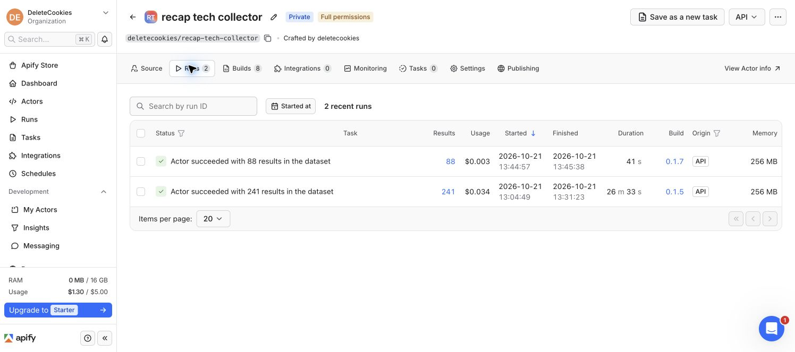

# D22 collection and workspace verification

21 October 2026. Scoped authorization: the founder's named **tech** collection and bounded 30-day collection in their existing **DeleteCookies** organization. [Delivery plan](PLAN.md), [source identity research](access-research.md), [sanitized aggregate evidence](evidence/collection-summary.json). No private app identity, saved reader record, credential or raw source body is published in this report.

## Actual result

The actual owner workspace contains the active, editable **tech** collection with **39 researched public sources**. Existing preferences, saves and nine fictional sample follows were preserved. Samples remain outside the tech collection. Six creator identities, including three publishing groups, keep studio, person and channel relationships separate. GNSteve is included on official ownership evidence; nine unresolved properties remain excluded rather than guessed. A channel association does not invent an update's speaker or author credit.

The bounded window is **21 September 2026 11:01:09.961 UTC to 21 October 2026 11:01:09.961 UTC**. Imported and read back **278 unique private archive rows**, with exact ID comparison and no stale extra rows in the collection. Supplier collection succeeded for useful items from **20 of the 39 sources**:

| Platform | Selected sources | Sources returning accepted updates | Imported updates |
| --- | ---: | ---: | ---: |
| YouTube | 21 | 13 | 184 |
| X | 10 | 3 | 76 |
| Instagram | 8 | 4 | 18 |
| Total | 39 | 20 | 278 |

**175 items contain existing captions, 93 contain source/post text, and 10 are metadata only.** Two caption strings reach the explicit 200,000-character storage limit and are marked clipped. A 209 KB caption record exposed the old archive limit; the new 1 MB UTF-8 JSON limit preserves that item without trimming it to fit the small workspace settings document.

All **39 source reports retain `complete: false`**: 20 returned items with completeness unverified; 11 reported no accessible items/empty formats; seven returned no matching results without proof of a quiet month; TechLinked Instagram reported a blocked request and remains failed/partial. No item or format cap was hit. Empty/private/filtered responses are not evidence of complete access or inactivity. Existing captions establish available spoken text, not visual coverage. No AI synthesis, generated transcription, sentiment, comment or audience analysis was performed.

The frontend uses **30 calendar days in the reader's chosen timezone**, while this collection used the fixed rolling UTC window above. A first-day item can therefore be retained in the archive but excluded from the default view. **All available history** exposes retained items; the actual hosted visible count is recorded separately below.

## Provider execution and cost

Private Actor: [DeleteCookies / recap-tech-collector](https://console.apify.com/organization/HSYACi7hQoFfaaYkq/actors/IGSuksdW9ZsWkrsRj). It remains private with no recurring task/schedule. Latest successful build **0.1.8**, `w8wei9JLcWWhKwmMK`, contains the final offline diagnostic corrections; it was built without another collection run. Actual collection used:

- Controller `ljOOTSb0X3LxXSqBo`, build **0.1.5**, 38 source runs, 202 accepted updates.
- Controller `HqRC9Byt2VJOplL1D`, build **0.1.7**, GNSteve and all ten X sources, 76 accepted updates.
- Two separately capped Xquik proofs: one returned no items; one returned five real MKBHD posts. Those posts are already represented in the subsequent collection and were not imported again.

API Dojo's free response consisted of `demo:true` placeholders; all were rejected. The current reviewed, pinned **Xquik** route returned actual attributable dated posts without a new subscription. Legacy run references and reviewed supplier metadata remain intact. Future provider changes require their own review; a marketing capability claim does not establish collection success.

Actual private admin/database telemetry records **53 distinct collection runs across five distinct Actors**, plus **eight builds recorded separately**. There are no requested/running jobs. All supplier runs report SUCCEEDED, which does not override the content-level failures and gaps above. Controller dataset row counts include report/manifest records; the Apify Console's 241/88 result counts are not accepted-update counts. Its controller-only fee column also excludes the child supplier charges.

At **11:57 UTC**, observed run usage was **US$1.296381212221**, builds **US$0.006867111116**, combined **US$1.303248323337**. The organization's overall current cycle showed about **US$1.306 of its US$5 allowance**; that includes other organization usage and is a different measure. These are provisional observations paid from existing free credits, not a final invoice or measured all-in operating cost. No new cash purchase, plan upgrade or supplier subscription was made.

A supplier fee was observed increasing after its run became terminal. Consequently, full API-cap reservations remain held; terminal status and an observed zero/small fee do not release them. The **US$45 shared envelope is a hold, not US$45 spent**. Its child/build commitments total about **US$42.286867**, within that envelope. The ceiling remains bounded by the prior EUR50 approval; no recurring budget was authorized. Generated transcription remains **0/150 minutes**.

## Implementation and safety evidence

**355 automated tests passed**, TypeScript and production build passed, and the original public catalogue reproduces unchanged at 560 creators / 600 platform accounts. The offline tech manifest validates 39 included sources, zero optional and nine unresolved with zero network/database/job actions. Actor runtime dependency audit reported zero known vulnerabilities. The official Apify input-schema validator passed before execution; subsequent changes affect diagnostic normalization, not the schema.

All eleven project migrations match hosted migration history, including the private paged archive, 1 MB row allowance, precise observed fees, aggregate budget controls, guarded admin summary and atomic workspace/archive clearing. [Hosted safety checks](evidence/hosted-safety-summary.json) cover ownership, anonymous/ordinary-account boundaries, concurrent budget allocation, idempotent one-shot claims, stale-revision deletion prevention and rollback. Synthetic checks left zero fixtures. A separate rollback-only hosted size check accepted a 250 KB record and rejected over 1 MB. Last completed security-advisor check reported no issues; a later connector refresh lacked permission, so it is not represented as a new advisor pass.

Actual provider reconciliation performs GET reads and database accounting only: no build/start/retry operation exists in that script. It verifies organization, exact supplier Actor/build/pricing, source/run identities, actual start/finish times and consumer links. It retains the highest observed fee when a stale response would lower it, and does not finalize unknown invoices. Independent read-only inspection confirmed all 53 expected run records, consumer links, run-budget bindings and exact 278 archived IDs.

[Local UI evidence](WORKSPACE-CHECKS.md) uses explicitly synthetic guest fixtures, including phone viewport, collection editing, archive paging/cancellation, real channel bylines and source-only/coverage notices. It is separate from the actual signed-in production checks below. Private owner follows, email and account identifiers are deliberately absent from screenshots and Git.

## Release and hosted browser evidence

First production code `d8c78d8` passed [CI 39590198838](https://github.com/raduvlad92/recap/actions/runs/39590198838) and Netlify deploy `6ad89e3bead8eda29a0e2a54`. The actual existing Chrome session showed the tech collection and imported private history. This predates the final channel-identity and provider-diagnostic fixes.

Final checked code push, exact-commit deployment and owner/admin browser readback are being completed. They must be recorded here before final handoff; neither local tests nor the previous deployment establishes those results.

## Remaining work

No additional owner access step is needed. The collection is a bounded manual backfill; hosted scraper execution and automatic refresh remain disabled. Useful history exists, but the 19 empty/blocked source results and complete-month coverage need further investigation. Broad seven-family source proof and the original seven-day observation are unfinished. AI topic synthesis/brand/sponsor extraction, multilingual recap quality, daily generation/reminders, production Clerk setup, correction/raw-retention policies and full cross-service deletion remain separate tracked engineering work. The public catalogue has no private owner recap and SEO publication does not establish search indexing or rankings.
