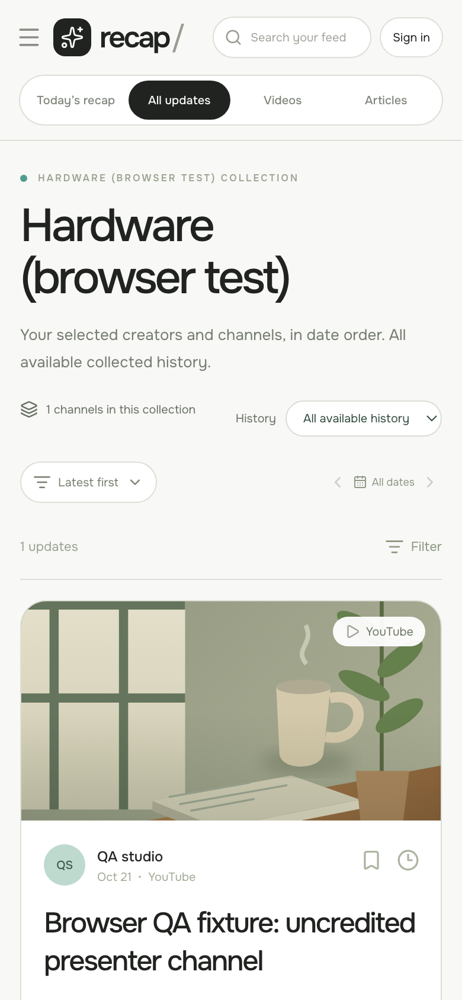
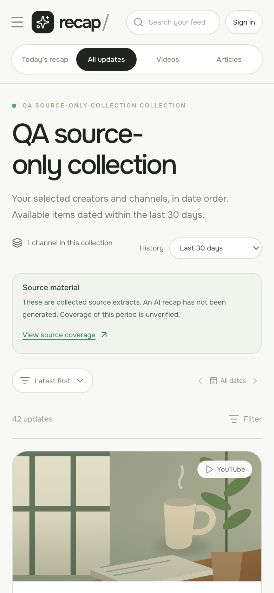

# D22 source collections and studio navigation

21 October 2026. Frontend implementation and local browser checks; this note is not evidence of supplier collection, a hosted release, or owner provisioning.

## Saved model

Workspace JSON stays at version 1. Existing settings, saved updates, read-later items, follow scopes and manual feed imports keep their format. Optional additions:

```ts
customCreators?: Creator[]
sourceCollections?: { id: string; name: string; sourceIds: string[]; createdAt: string }[]
activeCollectionId?: string
```

Custom creators use the existing person/studio model, including channel IDs and evidenced presenter IDs. IDs stay unchanged. Sanitization prevents replacement of sample identities, removes unknown channel/presenter references, and only allows people as studio presenters. Limits: 200 custom sources, 200 custom creators, 30 collections; existing 50-source / 15-X follow allowances are unchanged. Collection membership and following are separate choices. Removing a collection keeps sources, follows, saved items and collected history.

A seeded active collection opens by default with the last 30 calendar days in the reader's timezone. Readers can choose all available history; that view choice is local to each collection while the page is open. Reload returns named collections to the 30-day view. The all-source view and saved/read-later libraries remain accessible. Person selection includes owned channels even if a particular update has no presenter credit; it does not fabricate contributor IDs.

## Separate archive

The authenticated workspace client reads `reader_source_updates.record` in 1,000-row pages, ordered by ID and filtered to the current authenticated owner. Each request has the existing account-generation and abort guards. It loads when `sourceCollections` exists, including an empty array, so removing the final collection does not make retained archive history disappear. Legacy workspaces lacking this field do not query the new table.

Archived records are sanitized and merged only into the exposed update list. An archive record wins a duplicate imported ID. Full transcript strings are retained in the separate archive view; they are not shortened to satisfy the workspace JSON size limit or copied into cloud-saved workspace JSON. Failed archive reads and invalid/dangling records produce visible notices. Retrying history now refreshes only archive state; local metadata drafts, pending saves and conflict state are not reloaded or discarded. Export includes `archivedUpdates` and any archive error notice separately. Reset/delete now call `clear_reader_workspace` once, with the current nonnull workspace revision. The authenticated database transaction checks that revision before clearing either store. Stale revisions leave both stores unchanged; reset records the returned revision without a follow-up write. The action waits for pending changes to save. Collection deletion alone does not delete archive rows.

Live authenticated archive/RLS verification is a separate parent-task checkpoint. These browser checks used guest fixtures and did not claim a real archive read or deletion.

## Design choices

Reference: the founder's supplied offwhite feed with creator navigation on the left and a signal map on the right. Preserve that reading layout. Palette: canvas `#f8f8f6`, paper `#ffffff`, ink `#20231f`, lines `#dedfd9`, teal `#519c8d`, supporting text `#687163`. Onest remains the typeface. Collection controls fit above the existing source list, rather than introducing a separate dashboard.

```text
[collection picker] | [dated updates / selected creator] | [signal map]
[studio > person]  | [30 days / all available history]  | [topics]
[   > channels]    | [source-linked update cards]       | [interests]
```

Controls are left aligned, with native labelled selects, visible focus, and membership checkboxes. Mobile moves the same collection and source navigation into the existing source drawer. Large feeds reveal 40 cards at a time with a working Show more updates control; counts and filters continue to include the full result set. No generic dashboard, added chart or invented growth metric was introduced.

## Local browser evidence

Used an isolated T3 incognito guest tab at `http://127.0.0.1:5173/`. Synthetic browser fixtures used `example.org` URLs, a QA studio, a QA presenter, two channels and three updates, including one older item. The fixture explicitly described itself as synthetic. No authenticated owner account or supplier was mutated.

- Actual measured desktop viewport: **1280 × 800**; document width 1280; no horizontal overflow.
- Actual measured phone viewport: **390 × 844**; document width 390; no horizontal overflow. These are evaluated `innerWidth`/`innerHeight`, not just requested resize metadata.
- Seeded active named collection displayed two recent cards and excluded the old update and fictional sample feed. No sample notice appeared.
- Studio expansion exposed the nested presenter and channels. Selecting the presenter showed their owned-channel update with empty contributor IDs.
- Selecting all available history restored the older item without importing sample items.
- Renamed the collection and removed one member using the actual editor. Browser storage persisted the new name/membership; follows, custom sources and three history records remained unchanged.
- Created an empty collection through the phone drawer/editor. It displayed zero cards, a meaningful empty state, and no substitute sample items.
- Reload retained both named collections, active selection and edited membership. Its history control returned to the documented 30-day default.
- Switched between collections through the phone drawer. Removed a collection; all-source view remained usable and both sources, follows and three update records were preserved.
- A browser fetch guard observed **zero `/api/collect` calls** during these checks; the post-reload resource list also contained zero collection requests. No collection button was used.
- Guest storage was restored after the checks.



## Automated checks

The focused source-collections suite has 13 cases: old v1 compatibility, saved hierarchy round trip, invalid-reference/fixture protection, overlapping custom follows, uncredited owned-channel navigation, membership editing, collection removal, import preservation, timezone-aware 30-day selection, all-history selection, empty real collections, long archive transcripts and archive correction priority without workspace mutation.

`npm run typecheck` passed. The full test suite passed at 227 tests during parallel implementation. A subsequent full run while the collector agent was editing encountered its unrelated aggregate-item-cap test failure (`provider_budget_exceeded` in `tests/tech-collector.test.ts`); the frontend/domain suite remained passing. Final full-suite/build/hosted evidence belongs to the parent integration checkpoint.

## Review fixes and follow-up checks

The focused review found four issues: archive deletion before workspace CAS, an archive Retry path that discarded pending metadata drafts, an unguarded optional creator array in the admin summary SQL, and insufficient visibility of source-only/incomplete coverage. The parent added the atomic reader-clear RPC and guarded SQL array handling. The frontend now uses that RPC, keeps archive retry separate from workspace reload, and exposes coverage before a reader opens an item. Static inspection found no additional cross-account read or admin privilege escalation in these changes; live authenticated/RLS proof remains a separate integration checkpoint.

The collection and Today views now show: **Source material. These are collected source extracts. An AI recap has not been generated. Coverage of this period is unverified.** The history heading says available items dated within the selected period. Cards distinguish metadata-only records, existing captions and source text. View source coverage opens each source's stored description/report, item/content counts, and a clear statement that zero returned items does not prove a quiet channel.

A second isolated guest fixture verified the banner and source coverage panel at actual **390 × 844**, document width **390**. The panel displayed the synthetic capped-coverage report and **42 metadata-only items**, with zero existing-caption/text counts. The banner also remained visible in Today view. The feed first rendered 40 cards and Show more updates revealed all 42. No `/api/collect` requests occurred. Guest storage was restored afterward.



Five additional archive-reader tests cover paging beyond 1,000 records, invalid/foreign-source rejection, an in-flight response arriving after cancellation, preventing another page after cancellation, and surfacing page failure instead of claiming partial results are complete. The three focused domain/collection/archive suites passed **60 tests**, and typecheck passed after these fixes. These are not live database reset/delete or authenticated owner-browser checks.
